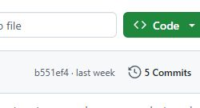
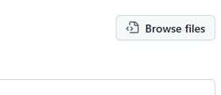

# Guided GitHub practice

Perform one action, check the completion cue on your own screen, then pause. Keep your existing repository and work.

[Editable slides](../slides/GitHub_Hands_On_EN.pptx) / [slide-only PDF](../slides/GitHub_Hands_On_EN.pdf) / [three narrated, captioned videos](../../videos/github/README.md) / [complete setup guide](setup.md)

The videos explain public-template and GitHub Docs screenshots. They do not show a student's Private repository or your university form. Example owners and names must be replaced with your own.

## A. Reach your own Private repository

1. Sign in to [GitHub](https://github.com/login). New users [sign up](https://github.com/signup) and follow the verification email. Keep an existing account. GitHub and your university page have separate sign-ins. Note your username from your Profile URL; follow the setup guide to verify the required email. Enter passwords and sign-in codes yourself.
2. If you have not created your repository, open the [English student template](https://github.com/tsuchiyatakahirolab/ai-data-literacy-student-template-en). Choose Use this template, then Create a new repository. Choose your own Owner, name it `ai-learning`, select Private, and confirm with Create repository from template or the equivalent creation button.
3. Check **your username / ai-learning**, **Private**, and the `setup`, `week01`–`week14`, and `final` folders. Bookmark your own repository. A Star, Follow, or bookmark does not create a copy. If folders are missing, or you used Fork or Public, preserve your work and ask for help before recreating it.

**Pause:** show your own Owner, Private, and folder list. If the setup image and record are missing, continue the [setup guide](setup.md). Creating the repository alone has not saved the required image.

## B. Edit, save, and reopen README

1. In your own repository, open the week specified by your instructor, then README.md. Read the lesson in the instructor repository and write in your own file. Click the pencil. If it is missing, check ownership and sign-in. Stop if you are asked to fork or propose changes.
2. Keep existing work and headings. Add one sentence about a check you actually performed under your checking record. Use Preview to check the appearance, then Edit to correct it. **Typing and Preview have not saved the change.**
3. Click Commit changes… to open the save dialog. Enter a brief message. In your own course repository, choose Commit directly to the main branch and confirm with the final Commit changes button. Ask for help if direct saving is unavailable.
4. Reopen README and check that your sentence remains. Browser commits need no separate push.

**Pause:** show your saved sentence outside the editor.

## C. Invite the instructor and submit a specific version

1. Open **repository Settings**, then Collaborators in Access, then Add people. Check the full instructor username specified for your course, select the match, and confirm the final Add button. Searching alone does not send the invitation. Pending means your invitation was sent; instructor access awaits acceptance. Keep an accepted invitation. A Private URL, Star, or Follow does not grant access. Keep the repository Private.
2. If initial registration is incomplete, finish the setup image, short record, and invitation, then send **your repository URL** through the existing initial form on your course page. Check the form confirmation. There is no separate Week 00 form.
3. Save all the weekly files. Return to Code at your own repository root. Click the clock icon and the number beside **Commits**, at the upper right of the file list. On a narrow screen, the icon may appear alone. If you cannot find it, click the latest save message in Code. With your instructor's help, you can also append `/commits/main/` to your own repository address.

4. In the history, open the newest message after all required files were saved. Check the author, time, and description. The address contains `/commit/` and the identifier. Copy SHA copies only the identifier; it is not the full submission URL. Verified concerns the commit signature, not course grading or form receipt.
5. Use **Browse files** on that commit page to inspect the full version. Open the correct week and check README and all artifacts. If a file is missing, save it and use the newer final commit. Return to the `/commit/` page before copying the URL; do not submit the `/tree/` address from Browse files.

6. Copy the full address bar URL. Windows: Control L, Control C, then Control V in the form. Mac: Command L, Command C, then Command V. Open the existing weekly form from your course page, check the required account and week, paste the commit URL, and submit. Check the form confirmation separately from GitHub saving.

**Pause:** show the invitation state and the checked commit URL. Confirm form receipt separately. Keep existing deadlines and resubmission policies.

## Completion cues

- [ ] Your own username / ai-learning, Private, and folder list.
- [ ] The actual setup image and short record open in your repository.
- [ ] The weekly README reopens with your saved text.
- [ ] The specified instructor appears in the collaborator list as pending or accepted.
- [ ] Initial registration has a form confirmation. Weekly submission separately has a commit URL containing all required files and a weekly form confirmation.

These cues describe your operation. Instructor access, roster matching, batch-check results, and grades are separate. If stuck, report the step and visible error without sharing passwords or sign-in codes. Keep existing work. Self-study readers can omit university registration, invitations, and forms.

Public-template history screenshots were captured on 2026-10-14. Existing GitHub Docs screenshots were retrieved on 2026-10-06; their original capture dates are unknown. The procedure was checked again on 2026-10-14. See [image provenance](../../assets/github-handson/SOURCES.json).

Official sources: [create from a template](https://docs.github.com/en/repositories/creating-and-managing-repositories/creating-a-repository-from-a-template), [edit files](https://docs.github.com/en/repositories/working-with-files/managing-files/editing-files), [invite collaborators](https://docs.github.com/en/repositories/managing-your-repositorys-settings-and-features/repository-access-and-collaboration/inviting-collaborators-to-a-personal-repository), and [commit signature verification](https://docs.github.com/en/authentication/managing-commit-signature-verification/about-commit-signature-verification).
