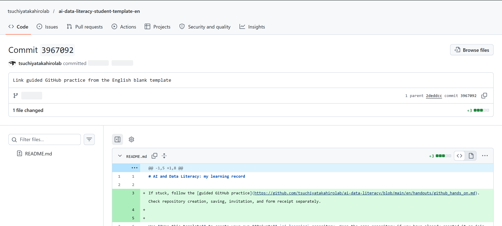

# Try three ways to use AI

Read this sheet alongside the [English slides](../slides/Week01_AI_Landscape_EN.pptx). Work in your own private repository. The instructor supplies course-specific accounts, submission links, and deadlines.

[Lesson and requirements](../core/week01.md)

## Practice files

- [ai_try_10.md](../assets/week01/ai_try_10.md)

## Follow the slides

### 2. What you will make today

Three AI tasks

Try three tasks  
with the same AI.

Your own check

Record one thing  
you verified yourself.

Your first submission

Save on GitHub. Submit the commit.

### 3. What AI can do

Talk and explain

Read documents

Research information

Work with numbers

Create images

Plan a task

One AI may offer several capabilities. Availability depends on your account and environment.

### 4. AI services and what they can do

Choose a service

Open an AI service. Use it for all three tasks.

Choose a useful capability

Ask for an explanation.  
Rewrite the same text.  
Organize steps or constraints.

### 5. Get ready for the exercise

01

Open your AI.

Use an AI available for your course or one you already use.

02

Start a new conversation.

Keep names, student IDs and friends' personal details out of the prompt.

03

Open the handout.

Copy the prompts from en/handouts/week01.md.

### 6. 1. Ask AI to explain a term

Copy this prompt, then add the specified source material:

```text
I am a first-year university student.
Explain what a mean is using an everyday example
in about 150 characters.
```

Check whether you can explain the example in your own words.

### 7. 2. Rewrite the explanation for a new reader

Copy this prompt, then add the specified source material:

```text
Rewrite that explanation for a primary-school student.
Keep the meaning of the numbers unchanged.
```

Compare the wording and numbers with the original explanation.

### 8. 3. Plan the order and time for each task

Copy this prompt, then add the specified source material:

```text
I have 30 minutes for an assignment.
Divide the time between reading the material,
organizing the main points and checking my work.
The total must be 30 minutes.
```

Add the times yourself and check that they total 30 minutes.

### 9. Record what you checked

Too little detail

It was easy to understand.  
It was useful.

Describe your actual check

I added the suggested times.  
10 + 15 + 5 = 30 minutes.  
No change was needed.

### 10. Check the AI response yourself

Can you explain the idea in your own words? Does the schedule add up to the required time? Check at least one result yourself.

### 11. If a feature is unavailable

No voice input

Send the same request  
as text.

No attachments

Type a prompt and continue.

Usage limit reached

Check your result. Record the feature you could not use.

### 12. Your work and your checks

week01/

README.md:  
Three AI uses you tried

Your README record

What I delegated to AI  
What I checked myself  
What I could not verify

### 13. Save your README edit

1. Open your own private repository and select `week01/README.md`. Check the owner in the address bar.
2. Select the pencil icon. Add your work and a short record of what you checked.
3. Select **Commit changes** and confirm in the dialog. Check that your edited text appears when the file opens again.


### 14. Open the commit history

Open the **Code** tab in your repository. Above the file list, choose the clock icon and **Commits**. Look for a page headed **Commits**.


### 15. Choose the commit to submit

Find the change you saved and select its message. Check the date and the changes. The detail page shows **Commit** followed by a short identifier.


### 16. Check the files and copy the commit URL

1. Select **Browse files** and check the expected work under `week01/`.
2. Return to the commit detail page.
3. Select the full address with **Ctrl+L** on Windows or **Command+L** on Mac. Copy it with **Ctrl+C** or **Command+C**.
4. Check that the address includes `/commit/` and your own GitHub username.
5. In class, submit the full address through the course form under **Week 01** and check the confirmation page. For self-study, keep the address in your practice log.



Use the repository URL for initial registration and the full commit URL for an assignment. Work in your own repository while following the screen examples.

### 17. Before you submit

I described the results of three AI capabilities.

I recorded what I checked and what I found.

I kept personal details out of the prompts and saved work.

I submitted the commit URL containing my work.

## Save and submit

Save the artifact and a short AI-use record in `week01/README.md`, then commit all required files. Submit the **final commit URL** through the course form. Initial registration uses the repository URL; weekly and final submissions use a commit URL.

Do not include student IDs, university emails, passwords, or confidential source material. Full AI chat histories are not required. Self-study readers can complete the exercise without university forms.

Character limits in prompts follow the source exercise. Follow any language-specific length specified by your instructor.
