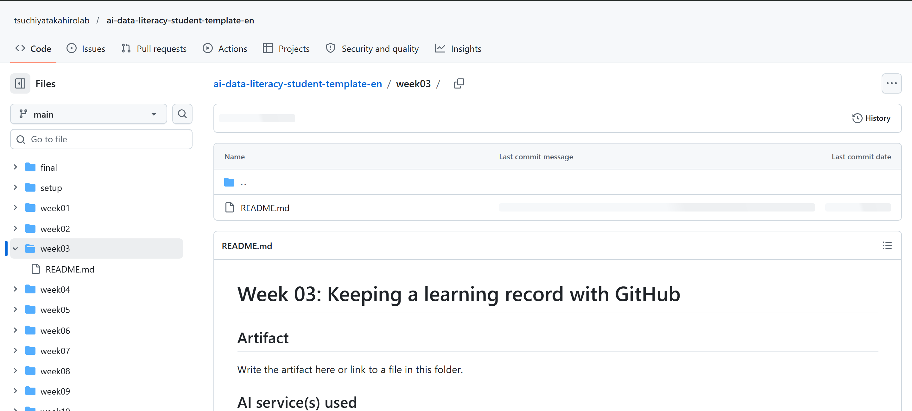
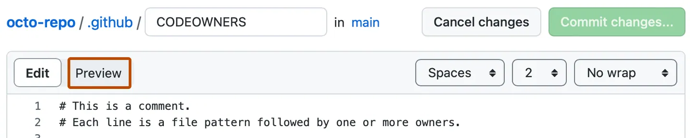
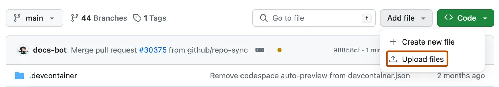

# Check the version you saved on GitHub

If GitHub operations are difficult, use the [guided practice](github_hands_on.md) and [short videos](../../videos/github/README.md) first.


Read this sheet alongside the [English slides](../slides/Week03_GitHub_Workflow_EN.pptx). Work in your own private repository. The instructor supplies course-specific accounts, submission links, and deadlines.

[Lesson and requirements](../core/week03.md)

## Practice files

- [github_terms.md](../assets/week03/github_terms.md)
- [practice.txt](../assets/week03/practice.txt)

## Follow the slides

### 2. Edit, compare, and submit

Edit

Add a short entry and save it.

Compare

Compare the edits in the diff.

Identify the version

Check the version. Submit its URL.

### 3. How Git and GitHub work together

Git

Records file change history.  
A commit saves a version.

GitHub

Hosts files managed with Git.  
You can also edit them  
in a browser.

### 4. One file, several saved versions

First version

Ask AI for an explanation

Revised version

Add information  
checked against a source

Version to submit

Read it again and  
choose the version to submit

A change history alone does not prove accuracy or who did the work.

### 5. Open week03 in your repository

Open your own private repository and check that the owner in the URL is your GitHub username. Select week03, then open README.md. The breadcrumb shows which folder you are in.



### 6. 1. Write a short learning record

Enter this in the README

## What I delegated to AI  
I asked AI to explain a term.  
I followed up on the part I did not understand.

This is an editing example. Replace it with what you actually did.

### 7. Save your first edit

Use Preview to check the display. Select Commit changes, write a short message about the edit, and confirm the save. Check that your new text appears when you return to the file.



### 8. 2. Add what you checked

Enter this in the README

I checked the term in the course material.  
Its meaning matched AI's explanation.  
  
Write what you actually checked yourself.

Keep the first text and add a record of your check.

### 9. Read the added lines in the diff

Existing text

I asked AI to explain a term.  
I followed up on the unclear part.

＋

I checked its meaning in the course material.  
It matched AI's explanation.

Added lines in the example are green and marked with +. Read the text of those lines.

### 10. Check the second commit

Add what you checked to README.md and save again. Open that commit from Commits. Compare the text you added with the lines marked with +. A diff shows what changed in that commit.


### 11. Repository URLs and commit URLs

Repository URL

github.com/your-username/ai-learning  
  
Opens the whole repository.  
It does not fix a submitted version.

Submitted version URL

github.com/your-username/ai-learning  
/commit/commit-hash  
  
Identifies this commit's version.

These examples show the format. Copy the whole URL from your browser.

### 12. Check the files in the version you will submit

01

Open the commit you will submit.

This page mainly shows the files changed in that commit.

02

Open that version using Browse files.

You can inspect all files as they were at that commit.

03

Open week03 and its README.

Check that this version contains every required file.

A file may be in this version even when it does not appear in the latest diff.

### 13. Add a practice file

Download the supplied practice.txt. In your own week03 folder, select Add file, then Upload files. Choose practice.txt and select Commit changes. Check that practice.txt appears in the folder and opens from the README link.



### 14. Add a file link to your README

Enter this in the README

```markdown
[Open the practice file](practice.txt)
```

Check the link in Preview. After committing, open the file using the link.

Images and PDFs work the same way. Match the filename and folder.

### 15. Save and submit in the browser

Edit in the browser

Edit the file. Commit it on GitHub.

Submit

Use the latest commit URL.  
  
Choose the assignment's week  
and submit the course form.

### 16. Where to save your image and record

01

Open your own ai-learning.

Read the instructor's course handouts.

02

Open your own week03 folder.

Keep the README headings when you edit.

03

Add required files using Upload files.

Check Preview and save with Commit changes.

Initial setup uses setup. This week's assignment belongs in your own week03.

### 17. Check the commit you will submit

01

Open your own week03 folder.

Check that your README and work are saved.

02

Open the latest commit.

Check that its version contains the required files.

03

Copy the displayed commit URL.

Submit the weekly form with the course's specified account.

Use the repository URL for initial registration and the commit URL for weekly work.

### 18. Common problems and fixes

Wrong repo

Check the owner. Open ai-learning.

File not visible

After saving, open your repo and check the file.

Instructor cannot open it

Check the invitee and whether the invite is pending.

### 19. Your work and your checks

week03/

README.md:  
Changes and verification results

Your README record

What I delegated to AI  
What I checked myself  
What I could not verify

### 20. Save your README edit

1. Open your own private repository and select `week03/README.md`. Check the owner in the address bar.
2. Select the pencil icon. Add your work and a short record of what you checked.
3. Select **Commit changes** and confirm in the dialog. Check that your edited text appears when the file opens again.


### 21. Open the commit history

Open the **Code** tab in your repository. Above the file list, choose the clock icon and **Commits**. Look for a page headed **Commits**.


### 22. Choose the commit to submit

Find the change you saved and select its message. Check the date and the changes. The detail page shows **Commit** followed by a short identifier.


### 23. Check the files and copy the commit URL

1. Select **Browse files** and check the expected work under `week03/`.
2. Return to the commit detail page.
3. Select the full address with **Ctrl+L** on Windows or **Command+L** on Mac. Copy it with **Ctrl+C** or **Command+C**.
4. Check that the address includes `/commit/` and your own GitHub username.
5. In class, submit the full address through the course form under **Week 03** and check the confirmation page. For self-study, keep the address in your practice log.


Use the repository URL for initial registration and the full commit URL for an assignment. Work in your own repository while following the screen examples.

### 24. Before you submit

I can explain the difference before and after editing.

I opened the files at the commit I submitted.

I used my own Private repository.

I submitted the commit URL containing my work.

## Save and submit

Save the artifact and a short AI-use record in `week03/README.md`, then commit all required files. Submit the **final commit URL** through the course form. Initial registration uses the repository URL; weekly and final submissions use a commit URL.

Do not include student IDs, university emails, passwords, or confidential source material. Full AI chat histories are not required. Self-study readers can complete the exercise without university forms.

Character limits in prompts follow the source exercise. Follow any language-specific length specified by your instructor.
