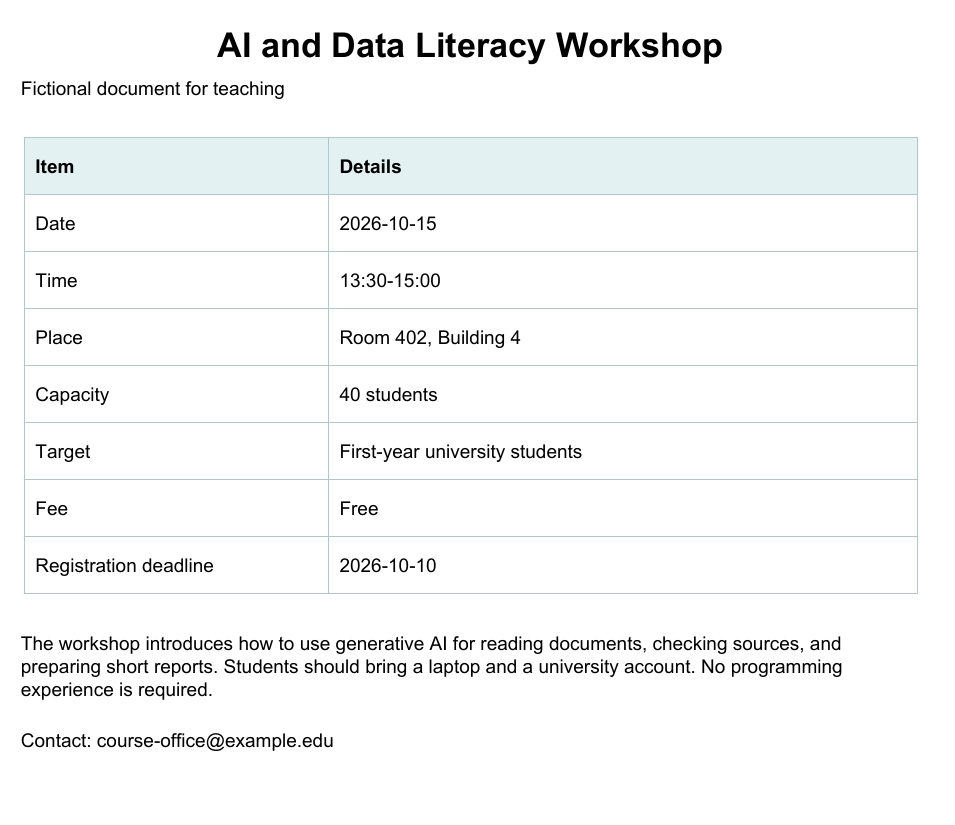

# Check AI's answer against the source

Read this sheet alongside the [English slides](../slides/Week04_Read_Documents_EN.pptx). Work in your own private repository. The instructor supplies course-specific accounts, submission links, and deadlines.

[Lesson and requirements](../core/week04.md)

## Practice files

- [sample_event_notice.md](../assets/week04/sample_event_notice.md)
- [sample_event_notice.pdf](../assets/week04/sample_event_notice.pdf)
- [sample_event_poster.png](../assets/week04/sample_event_poster.png)

## Follow the slides

### 2. Read a source and organize its facts

01

Give AI the supplied document.

Use the PDF, image or source text.

02

Organize what participants need to know.

Ask for the date, venue and items to bring.

03

Compare the answer with the original

Mark information absent from the source as unknown.

### 3. Read the fictional workshop notice

Open the supplied sample_event_notice.pdf. Find the date, time and venue, then read what participants need to bring. Keep the PDF open so you can compare AI’s answer with the original.



### 4. Attach the document to your AI chat

01

Save the supplied file to your computer.

Use sample_event_notice.pdf.

02

Use the attach button to select the file.

Wait for the upload to finish.

03

Check that the document name appears.

If attachments are unavailable, paste the corresponding .md text.

This is a short source. Pasting its text lets you do the same exercise.

### 5. 1. Organize information for participants

Copy this prompt, then add the specified source material:

```text
Using only this document, make a table
of the date, venue and items to bring.
For missing information, write Not stated.
```

Check the date, time and room number against the original, one item at a time.

### 6. Compare AI's answer with the original

| Item | Source content | Your own check |
| --- | --- | --- |
| Time | 13:30〜15:00 | Match / mismatch |
| Venue | Room 402, Building 4 | Match / mismatch |
| Bring | Laptop, university account | Match / mismatch |

Use this table for checking. Compare AI's actual output before marking a match.

### 7. 2. Ask about a detail the source omits

Copy this prompt, then add the specified source material:

```text
Are there power sockets at this venue?
Answer only what the document supports.
```

No information about sockets does not mean there are no sockets.

### 8. Keep missing information marked as unknown

Supported by the source

The notice does not state  
whether power sockets  
are available.

Unsupported by the source

There are no sockets.  
  
Or:  
Every seat has a socket.

### 9. Check how AI read the image

Did AI read the text correctly? Do the headings match the values in the table? Enlarge the original image to check hard-to-read text.

### 10. Correct AI's answer using the source

Copy this prompt, then add the specified source material:

```text
The venue is Room 402.
Check the venue field in the source and correct the table.
Check whether the other entries match the source too.
```

Use this request if there is an error. A correct result needs no correction.

### 11. Check the work you completed

I made a table of the date, time, venue and what to bring.

I checked every item against the original.

I identified one detail absent from the source.

I separated AI's assumptions from source facts.

### 12. Your work and your checks

week04/

README.md:  
Check table and missing information

Your README record

What I delegated to AI  
What I checked myself  
What I could not verify

### 13. Save your README edit

1. Open your own private repository and select `week04/README.md`. Check the owner in the address bar.
2. Select the pencil icon. Add your work and a short record of what you checked.
3. Select **Commit changes** and confirm in the dialog. Check that your edited text appears when the file opens again.


### 14. Open the commit history

Open the **Code** tab in your repository. Above the file list, choose the clock icon and **Commits**. Look for a page headed **Commits**.


### 15. Choose the commit to submit

Find the change you saved and select its message. Check the date and the changes. The detail page shows **Commit** followed by a short identifier.


### 16. Check the files and copy the commit URL

1. Select **Browse files** and check the expected work under `week04/`.
2. Return to the commit detail page.
3. Select the full address with **Ctrl+L** on Windows or **Command+L** on Mac. Copy it with **Ctrl+C** or **Command+C**.
4. Check that the address includes `/commit/` and your own GitHub username.
5. In class, submit the full address through the course form under **Week 04** and check the confirmation page. For self-study, keep the address in your practice log.


Use the repository URL for initial registration and the full commit URL for an assignment. Work in your own repository while following the screen examples.

### 17. Before you submit

I recorded where I checked in the source.

I verified the date, time and room number.

I avoided unsupported claims about missing information.

I submitted the commit URL containing my work.

## Save and submit

Save the artifact and a short AI-use record in `week04/README.md`, then commit all required files. Submit the **final commit URL** through the course form. Initial registration uses the repository URL; weekly and final submissions use a commit URL.

Do not include student IDs, university emails, passwords, or confidential source material. Full AI chat histories are not required. Self-study readers can complete the exercise without university forms.

Character limits in prompts follow the source exercise. Follow any language-specific length specified by your instructor.
