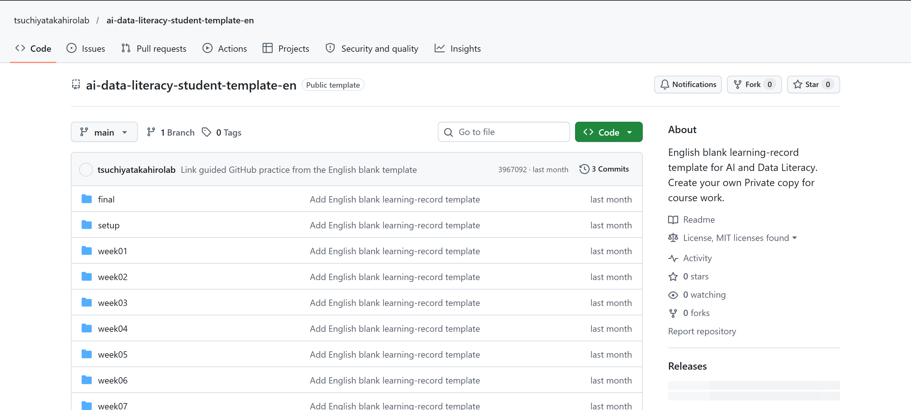

# Keep the meaning when you rewrite or translate

Read this sheet alongside the [English slides](../slides/Week05_Rewrite_Translate_EN.pptx). Work in your own private repository. The instructor supplies course-specific accounts, submission links, and deadlines.

[Lesson and requirements](../core/week05.md)

## Practice files

- [rewrite_source.md](../assets/week05/rewrite_source.md)

## Follow the slides

### 2. Adapt the same text for different readers

01

Read the original text.

Identify claims and conditions that must stay unchanged.

02

Create two versions.

Write for new students, then translate into a language you can check.

03

Check both versions against the original.

Check omissions, overstatements and changes in obligations.

### 3. Three ideas in the original text

Generative AI can help organize information,  
write text and understand documents.  
  
Its output may contain errors or weak support.  
In this course, record the AI and purpose of use.  
Check the final content yourself.

Display summary of en/assets/week05/rewrite_source.md. Use the supplied full source for the task.

### 4. What to keep in each version

Uses

Organize information.  
Help with writing  
and understanding text.

Limitations

Check for errors and weak evidence.

What to do

Record your AI use. Check the content.

### 5. 1. Rewriting for new students

Copy this prompt, then add the specified source material:

```text
Rewrite this text in plain English
for new university students.
Keep the uses of AI, the possibility of errors,
and the need to record use and check the result.
```

Paste the full rewrite_source.md text after the request.

### 6. Keep required actions clear

Meaning preserved

Record the AI you used  
and its purpose. Check the  
content before submitting.

Meaning changed

Check only the parts  
that concern you.  
Keeping a record is optional.

### 7. 2. Translate for another audience

Copy this prompt, then add the specified source material:

```text
Translate the same source into plain language
in another language I can verify.
Keep recording and checking as requirements.
Do not make them optional.
```

Check all three source ideas. Use a target language you can verify, or record the limitation.

### 8. Required and optional actions in translation

Matches the source

Record the AI tool used.  
Check the final content  
before submitting it.

Weaker meaning

You may keep a record if you find it useful. This makes it optional.

Teaching examples for comparison. These are not recorded outputs from a particular AI.

### 9. Compare your translation with the original

01

Review the three source ideas.

Uses, possible errors, and the requirement to record and check.

02

Find each idea in the translation.

Check unfamiliar words with a dictionary or course material.

03

Record anything you could not verify.

An AI back-translation alone cannot establish accuracy.

### 10. Record the comparison in three rows

| Source idea | Rewritten version | Check result |
| --- | --- | --- |
| Uses of AI | Find the matching passage | Kept / changed |
| Possible errors | Find the matching passage | Kept / changed |
| Record and check required | Find the matching passage | Kept / changed |

### 11. Your work and your checks

week05/

README.md:  
Rewrite, translation and meaning checks

Your README record

What I delegated to AI  
What I checked myself  
What I could not verify

### 12. Save your README edit

1. Open your own private repository and select `week05/README.md`. Check the owner in the address bar.
2. Select the pencil icon. Add your work and a short record of what you checked.
3. Select **Commit changes** and confirm in the dialog. Check that your edited text appears when the file opens again.


### 13. Open the commit history

Open the **Code** tab in your repository. Above the file list, choose the clock icon and **Commits**. Look for a page headed **Commits**.



### 14. Choose the commit to submit

Find the change you saved and select its message. Check the date and the changes. The detail page shows **Commit** followed by a short identifier.


### 15. Check the files and copy the commit URL

1. Select **Browse files** and check the expected work under `week05/`.
2. Return to the commit detail page.
3. Select the full address with **Ctrl+L** on Windows or **Command+L** on Mac. Copy it with **Ctrl+C** or **Command+C**.
4. Check that the address includes `/commit/` and your own GitHub username.
5. In class, submit the full address through the course form under **Week 05** and check the confirmation page. For self-study, keep the address in your practice log.


Use the repository URL for initial registration and the full commit URL for an assignment. Work in your own repository while following the screen examples.

### 16. Before you submit

I made two versions from the same source.

I kept recording and checking as requirements.

I recorded any translation details I could not verify.

I submitted the commit URL containing my work.

## Save and submit

Save the artifact and a short AI-use record in `week05/README.md`, then commit all required files. Submit the **final commit URL** through the course form. Initial registration uses the repository URL; weekly and final submissions use a commit URL.

Do not include student IDs, university emails, passwords, or confidential source material. Full AI chat histories are not required. Self-study readers can complete the exercise without university forms.

Character limits in prompts follow the source exercise. Follow any language-specific length specified by your instructor.
