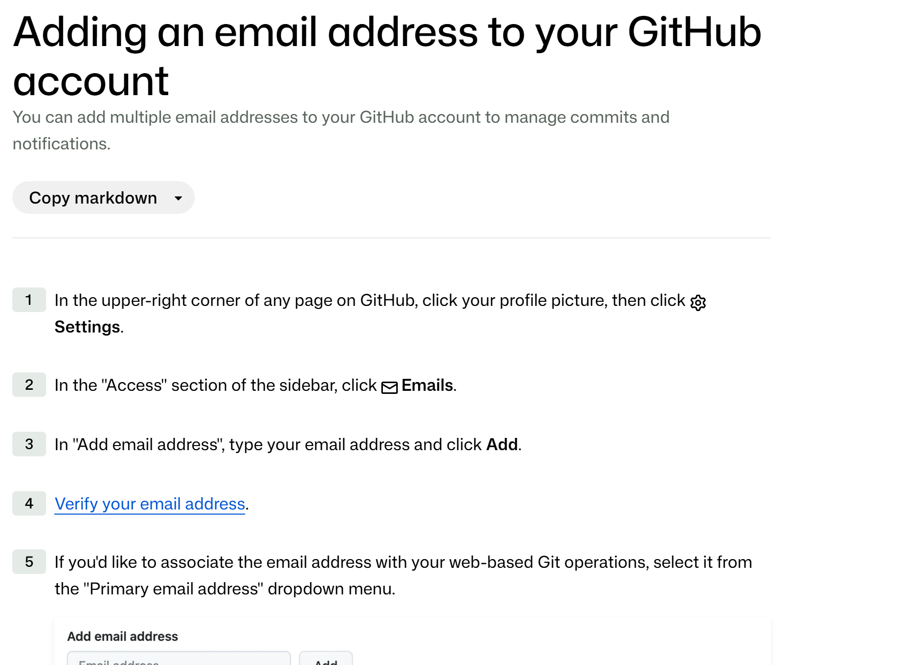
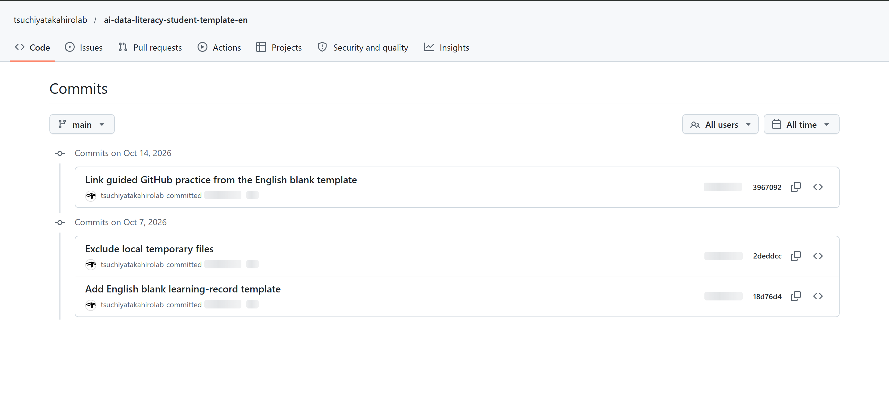

# Check AI's answer against its sources

Read this sheet alongside the [English slides](../slides/Week07_Check_Sources_EN.pptx). Work in your own private repository. The instructor supplies course-specific accounts, submission links, and deadlines.

[Lesson and requirements](../core/week07.md)

## Practice files

- [source_check_template.md](../assets/week07/source_check_template.md)

## Follow the slides

### 2. Where AI gets its information

Model training

Material you supplied

Web search

Connected data

The same chat interface can use different sources of information.

### 3. Check two claims against their sources

01

Choose the questions to check.

Choose specific information that could change over time.

02

Use AI to help find sources.

Search the web yourself if needed.

03

Open each source and check the answer.

Record the publisher, date and supporting passage.

### 4. Practice topic for GitHub email settings

Question 1: How do you verify  
a registered email address?  
  
Question 2: Can you add another  
email to an existing account?

Product details change. Record the official page and the date you checked it.

### 5. 1. Ask AI to find official sources

Copy this prompt, then add the specified source material:

```text
Use official GitHub documentation to find
how to verify an email and add another email.
For each item, show the page
that supports your answer.
```

Without AI web search, find official pages yourself and give AI the relevant text.

### 6. Read the relevant part of the source

Open GitHub Docs and check that the page heading matches your question. Read the steps that support the answer. Record the page URL and the date you checked it, and point to the relevant paragraph or step.



### 7. Read the source behind the link

Still unchecked

It included a link.  
It named an official site.  
AI said it was correct.

An actual check

I read the relevant paragraph.  
The email addition steps  
matched AI's explanation.

### 8. Four details to record about a source

Item

What to record

Information checked

What you investigated

Source and publisher

Page URL and publishing organization

Date

Date you checked and date updated, if available

Comparison result

Match, mismatch or unable to verify

### 9. If you cannot open a source

If a page is missing or restricted, look for another official source. If you cannot verify the claim, record why. Only cite URLs you have checked.

### 10. 3. Use evidence to correct a mismatch

Copy this prompt, then add the specified source material:

```text
This passage in the official documentation
does not match your earlier explanation.
Correct that part and separate what the source
confirms from what remains unknown.
```

Paste only the relevant source passage after this request.

### 11. Record your findings for both questions

I opened at least two source pages.

I connected each claim to the passage supporting it.

I recorded the date I checked.

I reported any mismatch or open question.

### 12. Your work and your checks

week07/

README.md:  
Questions, answers and source checks

Your README record

What I delegated to AI  
What I checked myself  
What I could not verify

### 13. Save your README edit

1. Open your own private repository and select `week07/README.md`. Check the owner in the address bar.
2. Select the pencil icon. Add your work and a short record of what you checked.
3. Select **Commit changes** and confirm in the dialog. Check that your edited text appears when the file opens again.


### 14. Open the commit history

Open the **Code** tab in your repository. Above the file list, choose the clock icon and **Commits**. Look for a page headed **Commits**.


### 15. Choose the commit to submit

Find the change you saved and select its message. Check the date and the changes. The detail page shows **Commit** followed by a short identifier.



### 16. Check the files and copy the commit URL

1. Select **Browse files** and check the expected work under `week07/`.
2. Return to the commit detail page.
3. Select the full address with **Ctrl+L** on Windows or **Command+L** on Mac. Copy it with **Ctrl+C** or **Command+C**.
4. Check that the address includes `/commit/` and your own GitHub username.
5. In class, submit the full address through the course form under **Week 07** and check the confirmation page. For self-study, keep the address in your practice log.


Use the repository URL for initial registration and the full commit URL for an assignment. Work in your own repository while following the screen examples.

### 17. Before you submit

I checked two pieces of information on the original pages.

I recorded check results as well as URLs.

I recorded another way to check when search was unavailable.

I submitted the commit URL containing my work.

## Save and submit

Save the artifact and a short AI-use record in `week07/README.md`, then commit all required files. Submit the **final commit URL** through the course form. Initial registration uses the repository URL; weekly and final submissions use a commit URL.

Do not include student IDs, university emails, passwords, or confidential source material. Full AI chat histories are not required. Self-study readers can complete the exercise without university forms.

Character limits in prompts follow the source exercise. Follow any language-specific length specified by your instructor.
