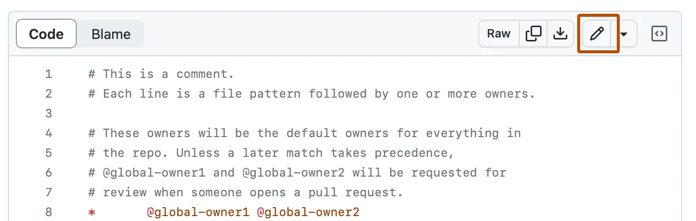

# Explain it yourself to check your understanding

Read this sheet alongside the [English slides](../slides/Week12_Learn_with_AI_EN.pptx). Work in your own private repository. The instructor supplies course-specific accounts, submission links, and deadlines.

[Lesson and requirements](../core/week12.md)

## Practice files

- [ai_tutor_case.md](../assets/week12/ai_tutor_case.md)

## Follow the slides

### 2. Use AI as a practice partner

Getting only the answer

Reading an answer alone doesn't show whether you understand it.

A practice partner

Ask for questions with answers hidden. Answer and check your reasoning.

### 3. Practicing correlation and causation

01

Ask for an explanation and example.

Understand why correlation and causation differ.

02

Think through three questions yourself.

Keep the correct answers hidden initially.

03

Compare the explanations with course material.

Check both your reasoning and AI's explanation.

### 4. 1. An everyday explanation

Copy this prompt, then add the specified source material:

```text
Explain correlation and causation to a first-year
university student using an everyday example.
Use a fictional example rather than a real study.
State that it illustrates the idea.
```

After reading, explain the difference in one sentence yourself.

### 5. Think of another reason for the same pattern

On hot days, ice cream sales are high.  
Swimming pools also have more visitors.  
  
Did selling ice cream cause  
more people to visit the pool?

Fictional example for reasoning practice. This is not observed data.

### 6. 2. Answer before seeing the key

Copy this prompt, then add the specified source material:

```text
Create three short questions that distinguish
correlation from causation. Ask them one at a time.
Wait for my answer before showing
the correct answer or explanation.
```

If you get stuck, ask for a hint before asking for the answer.

### 7. 3. Explain how you reached your answer

01

Decide whether the example supports correlation or causation.

If you cannot decide, explain why.

02

Think of one alternative explanation.

Identify a factor that could affect both variables.

03

Then read AI's explanation.

Compare it with your own reasons.

### 8. Checking AI's marking too

AI says correct

Is the reasoning correct too?  
Did you understand it,  
or only guess the option?

AI says incorrect

What difference did it identify? Does the question support it? Does it match the definition?

### 9. 4. Ask AI to explain a point that is still unclear

Copy this prompt, then add the specified source material:

```text
Which part of my explanation is unclear?
Explain just one point using the earlier example.
Then give me one similar practice question.
```

If you can explain it all, make another example yourself and check it.

### 10. Record your reasoning and checks

Record your reasoning and what you verified in the course material. If your answer was correct, keep a record of the check.

### 11. Save your work and your checks

week12/

README.md:  
Explanation, reasoning and checks

Your README record

What I delegated to AI  
What I checked myself  
What I could not verify

### 12. Save your README edit

1. Open your own private repository and select `week12/README.md`. Check the owner in the address bar.
2. Select the pencil icon. Add your work and a short record of what you checked.
3. Select **Commit changes** and confirm in the dialog. Check that your edited text appears when the file opens again.



### 13. Open the commit history

Open the **Code** tab in your repository. Above the file list, choose the clock icon and **Commits**. Look for a page headed **Commits**.


### 14. Choose the commit to submit

Find the change you saved and select its message. Check the date and the changes. The detail page shows **Commit** followed by a short identifier.


### 15. Check the files and copy the commit URL

1. Select **Browse files** and check the expected work under `week12/`.
2. Return to the commit detail page.
3. Select the full address with **Ctrl+L** on Windows or **Command+L** on Mac. Copy it with **Ctrl+C** or **Command+C**.
4. Check that the address includes `/commit/` and your own GitHub username.
5. In class, submit the full address through the course form under **Week 12** and check the confirmation page. For self-study, keep the address in your practice log.


Use the repository URL for initial registration and the full commit URL for an assignment. Work in your own repository while following the screen examples.

### 16. Before you submit

I explained my own reasoning.

I compared AI's explanation with the course material.

I separated what I understood from my remaining questions.

I submitted the commit URL containing my work.

## Save and submit

Save the artifact and a short AI-use record in `week12/README.md`, then commit all required files. Submit the **final commit URL** through the course form. Initial registration uses the repository URL; weekly and final submissions use a commit URL.

Do not include student IDs, university emails, passwords, or confidential source material. Full AI chat histories are not required. Self-study readers can complete the exercise without university forms.

Character limits in prompts follow the source exercise. Follow any language-specific length specified by your instructor.
