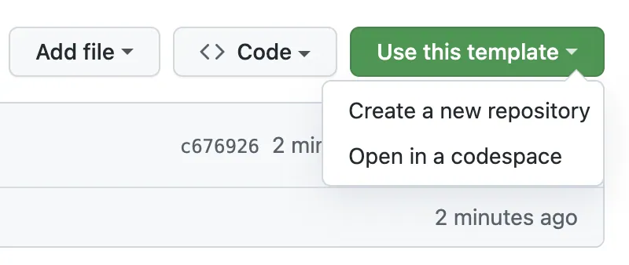
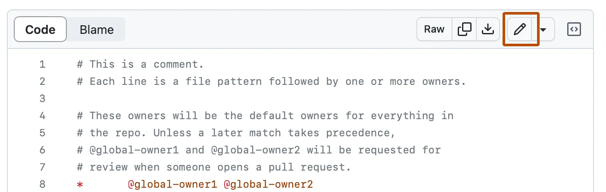
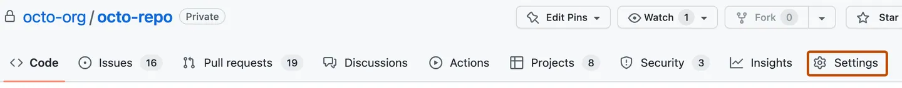
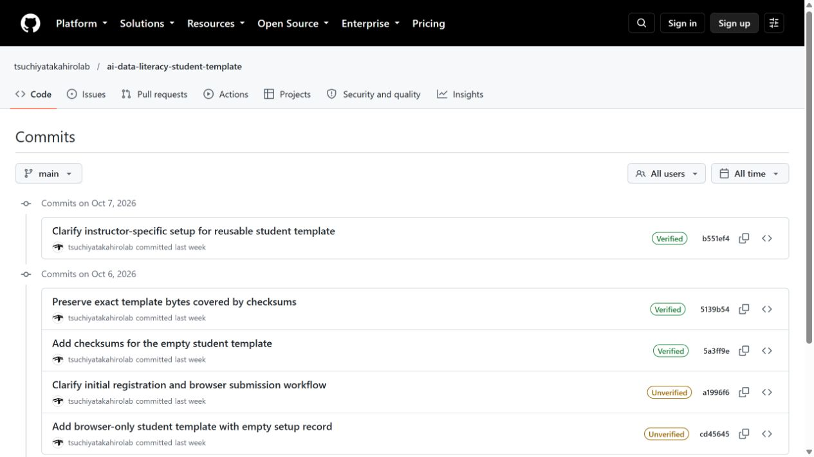

# GitHub操作を一緒に練習する

一度に全部進めず、**1つ操作したら、自分の画面で「できた目印」を確認して止まります。** 教員が次を案内するまで待ちます。すでにできている人は同じ保存先で続け、作り直しません。

[操作スライド](../slides/GitHub_Hands_On_JA.pptx)／[ノートなしPDF](../slides/GitHub_Hands_On_JA.pdf)／[短い解説動画3本](../videos/github/README.md)／[初回準備の詳しい手順](../docs/setup_handson_step_by_step.md)

動画は公開ひな形・公式文書の画面例を使った、音声と字幕付きの説明です。自分のPrivate保存先で操作します。教員や架空の例のusernameを、自分のusernameとして入力しません。

## 最初に、自分がいる段階を確認

| 段階 | 自分の画面で確かめること | ここから進める |
|---|---|---|
| GitHubに入れない | Sign inできるか。初めてなら確認メールを開いたか | A1 |
| 教材しか開いていない | Ownerが教員になっていないか | A2 |
| 自分の保存先がある | 自分のusername / ai-learning、Private、setup・week01等があるか | A3で確認してBへ |
| 保存はできるが教員に見えていない | SettingsのCollaborators一覧に指定教員がいるか | C1 |
| 保存したが提出URLが分からない | 自分の保存先のCodeで時計アイコンと○ Commitsがあるか | C2 |
| できたか分からない | 最後の5つの確認を一つずつ開いて示せるか | 最後の到達確認 |

作成済みの課題や保存先を消して解決しません。Forkした、Publicで作った、空の保存先でフォルダがないなどの場合は、今ある作業を残したまま教員へ相談します。

## A. 自分のPrivate保存先まで

### A1. GitHubのアカウントに入る

**開く：** [Sign in](https://github.com/login)。初めての人は[Sign up](https://github.com/signup)。大学の授業ページやGoogleとは別のアカウントです。

**操作：** 既存アカウントはそのまま使います。初めてなら画面の案内と確認メールを進めます。ログイン後、右上のプロフィール画像からProfileを開き、URLの`github.com/`の後にある自分のusernameを控えます。表示名やメールとは違います。大学メールの追加・Verified表示は[初回準備](../docs/setup_handson_step_by_step.md)で確認します。

**できた目印：** ログイン済みで、自分のusernameが分かる。パスワード・確認コード・CAPTCHAは本人が操作します。

### A2. ひな形を自分用にコピーする

**開く：** [授業の学生用ひな形](https://github.com/tsuchiyatakahirolab/ai-data-literacy-student-template)。別の授業では担当教員が案内したひな形を使います。

**操作：** Use this template、Create a new repositoryの順に選びます。Ownerは自分、Repository nameは`ai-learning`、公開範囲はPrivate。Create repository from template（画面によってCreate repository）で確定します。ボタンがなければログインを確かめます。

**できた目印：** 画面上部が「自分のusername / ai-learning」で、Privateがある。Star、Follow、ブックマークは保存先のコピーではありません。すでに作成済みなら新しく作らず、A3へ進みます。

### A3. 自分の保存先を開き直す

**開く：** 自分のai-learningのCode。`setup`、`week01`～`week14`、`final`があるか確認します。

**操作：** 自分のリポジトリURLをお気に入りに入れます。Codeの最上位URLは`https://github.com/自分のusername/ai-learning`です。初回登録はこのURLを使います。

**できた目印：** 自分のPrivate保存先をもう一度開ける。教員へOwner、Private、フォルダ一覧を自分の画面で示せる。

**ここで止まって確認します。** 画像と短い記録が未完了なら[初回準備の3～4](../docs/setup_handson_step_by_step.md)を続けます。画像は実ファイルをsetupへアップロードし、開いて確認します。コピーしただけでは画像提出は済みません。

## B. READMEの編集から保存まで

### B1. 書くファイルを開く

**開く：** 自分のai-learning、教員が指定した回の`weekXX`、`README.md`。読む場所は教員の教材、書く場所は自分の保存先です。

**操作：** ファイル右上の鉛筆を押します。鉛筆が見えない場合はOwnerとログインを確認します。Fork this repositoryやPropose changesが出たら、そのまま進めず教員へ相談します。

**できた目印：** 自分のREADMEを編集する画面が開く。画面例の別のファイル名は入力先ではありません。

### B2. 1行追記してPreviewする

**操作：** 既存の課題と見出しを消さず、「自分で確認・修正したこと」の下へ、実際に行った確認を1行追記します。実際に開き直した場合の例は「ファイルを開き直し、自分の追記が残っていることを確認した」です。まだ確認していないことは書きません。Previewで表示を確認し、直す場合はEditへ戻ります。

**できた目印：** 自分の追記が読める。**入力しただけ、Previewしただけでは未保存です。**

### B3. 保存を確定して開き直す

1. 編集画面のCommit changes…を押します。
2. 保存画面の説明欄へ「操作記録を追記」などと書きます。
3. 自分用の授業保存先ではCommit directly to the main branchを選びます。許可されない場合は教員へ相談します。
4. 最後のCommit changesで確定します。確認画面を開いただけでは保存が終わりません。
5. 戻ったREADMEを開き直し、自分の文章が残っているか確認します。ブラウザで保存した場合は、別のpush操作は要りません。

**できた目印：** 編集欄の外で、自分の追記が残っている。**ここで止まって、開き直した文章を確認します。**

## C. 教員への招待と提出する版のURL

### C1. 教員が読めるように招待する

**開く：** 自分のai-learningのSettings。GitHub全体のアカウント設定ではありません。見えなければ、Ownerが自分か、メニューにSettingsが入っていないか確認します。

**操作：** AccessのCollaborators、Add peopleの順に進みます。授業で指定された教員のusernameを入力し、最後まで一致する候補を選び、最後のAdd NAME to REPOSITORYを押します。検索しただけでは招待されません。教材の作者の例は`tsuchiyatakahirolab`ですが、別の授業では担当教員のアカウントに差し替えます。

**できた目印：** 教員がPending invite等で一覧にいる、または受理済みの協力者としている。招待中は学生側の送信済みであり、教員の実アクセスは受理後に確認します。受理済みなら再招待しません。PrivateのURLを教員へ送るだけ、Star、Followでは閲覧権限は付きません。Publicに変更して解決しません。

初回登録が未送信なら、画像と短い記録、招待を済ませ、授業ページの**既存の初回登録フォーム**へ自分の情報とリポジトリURLを送り、完了画面を確認します。新しいWeek 00フォームはありません。

### C2. commit履歴の入口を見つける

**開く：** 必要な課題ファイルを全部保存した後、自分のai-learningのCodeへ戻ります。フォルダ一覧の最上位です。

**操作：** 一覧右上の時計アイコンと「○ Commits」を押します。小さい画面では時計だけに見えることもあります。見つからない場合は、Codeの最上位の最新の保存説明を押してcommitを開けます。これも難しい場合、教員と一緒に自分の保存先のURLの末尾へ`/commits/main/`を付け、履歴を開きます。

**できた目印：** Commitsの一覧が開き、URLの所有者が自分。画像は公開ひな形の例なので、教員の履歴を提出しません。

### C3. 保存した最後の版を開く

**操作：** すべての必要ファイルを保存した後の最新の説明文を押します。作者・日時・保存の説明を確認します。URLに`/commit/`と長い英数字が含まれているか確認します。「Copy SHA」のボタンは英数字だけのコピーなので、提出用URLのコピーには使いません。

**できた目印：** そのcommitページが開いた。Verifiedはcommitの署名に関する表示で、教員の点検完了やフォーム提出完了ではありません。

### C4. Browse filesで内容を確認してURLをコピーする

**操作：** commitページ右上のBrowse filesで、その版のフォルダ一覧を開きます。指定回のREADMEと成果物が全部あるか確認します。不足があれば追加して保存し、追加後の最新commitへ進みます。確認できたら、ブラウザの戻る等でcommitページへ戻ります。

**できた目印：** 提出する版に必要なファイルが全部ある。提出用URLをコピーする際は、`/tree/`ではなく`/commit/`のページへ戻っています。

WindowsではCtrl+L、Ctrl+C、フォームでCtrl+V。MacではCommand+L、Command+C、Command+Vを使えます。コピーするのはブラウザのURL欄の全体です。

### C5. 授業の週次フォームへ送る

**開く：** 授業ページの既存の週次フォーム。授業で指定されたアカウントを使います。

**操作：** 指定の回を選び、確認したcommit URLを貼り付け、必要な項目を確認して送信します。初回登録のリポジトリURLとは異なります。

**できた目印：** フォームの送信完了画面が出た。GitHubでの保存、教員への招待、フォームへの提出は、それぞれ別に確認します。再提出・過去の締切の扱いは従来の授業方針に従います。

## 最後の到達確認

- [ ] 自分のusername / ai-learning、Private、フォルダ一覧を開いて示せる。
- [ ] setupの実画像と短い記録を開いて示せる。
- [ ] 今週のREADMEを開き直し、保存した文章を読める。
- [ ] Collaborators一覧で、指定教員の招待中または受理済みを確認できる。
- [ ] 初回登録の送信完了を確認した。今週の提出は、必要ファイルを含むcommit URLと週次フォームの完了画面で別に確認した。

チェックは自分で操作した状態の確認です。教員がまだ読めない、登録情報の修正が必要、授業の点検待ちなどは別の状態です。画面の読み込みやVerifiedだけで、点検合格・成績・提出を判断しません。

困ったら「A2で止まった」「B3の最後の保存ボタンが押せない」のように、止まった番号と画面に出た文を伝えます。パスワード・認証コードを見せません。初回登録や保存先を何度も作り直す前に相談します。独習者は大学の登録・教員招待・フォーム提出を省略できます。

## 画面例と出典

公開ひな形の履歴・commit画面は2026-10-14に撮影しました。学生のPrivate保存先や大学フォームの収録ではありません。公式文書の既存画面例は元の撮影日不明、2026-10-06取得、操作説明を2026-10-14に再照合しました。[撮影・素材台帳](../assets/github-handson/SOURCES.json)。

GitHub公式：[テンプレートからの作成](https://docs.github.com/en/repositories/creating-and-managing-repositories/creating-a-repository-from-a-template)、[ファイル編集](https://docs.github.com/en/repositories/working-with-files/managing-files/editing-files)、[協力者の招待](https://docs.github.com/en/repositories/managing-your-repositorys-settings-and-features/repository-access-and-collaboration/inviting-collaborators-to-a-personal-repository)、[commit署名の確認表示](https://docs.github.com/en/authentication/managing-commit-signature-verification/about-commit-signature-verification)。
