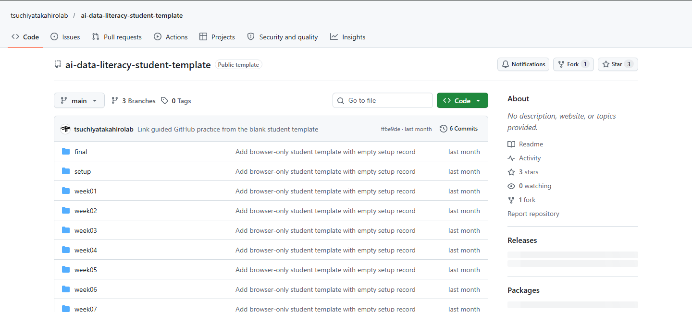

# グラフの軸と数値を確かめる

対応スライド：第10回

## この回で行うこと

軸と数値を確認し、印象と根拠を区別する。

## 使用する資料

- [chart_claim_data.csv](../assets/week10/chart_claim_data.csv)

## スライドを見ながら進める

### 2. 同じデータでも見え方が変わる

同じ値3.1、3.2、3.3、3.4、3.5を、縦軸0〜4と3〜4で比較します。

元データ：[`chart_claim_data.csv`](../assets/week10/chart_claim_data.csv)

教育用の架空データ。軸以外の値は同じ。

### 3. グラフの元データ

| 年 | reported_confidence |
| --- | --- |
| 2022 | 3.1 |
| 2023 | 3.2 |
| 2024 | 3.3 |
| 2025 | 3.4 |
| 2026 | 3.5 |

chart_claim_data.csv。数値の意味や測定方法は、別の説明も必要。

### 4. グラフを確認する順番

- 数値の意味：項目名、単位、対象期間を読む。
- 表示の方法：軸の始点と終点、目盛りを見る。
- 実際の変化：差を計算し、印象と比べる。

### 5. ① AIにグラフの比較を頼む

そのままコピーして使えます。内容は自分の課題に合わせて変更してください。

```text
2つのグラフを比べてください。
使っている値と、縦軸の範囲を確認し、
見た目の印象が違う理由を説明してください。
```

画像を渡せなければ、データと縦軸の範囲を文章で伝える。

### 6. 実際に増えた量は0.4

2022年の3.1から2026年の3.5への変化

3.5 − 3.1 = 0.4

「急増した」と書く前に実際の差を確かめる。 数値の尺度や調査方法も確認する。

### 7. 縦軸の範囲を変える目的

**0から示すとき**：棒の長さで値を比べる。 縦軸は0から示す。

**範囲を絞るとき**：範囲を狭めると 小さな変化が見やすい。 差が大きく見えるため 縦軸の範囲を明示する。

### 8. グラフだけでは分からないこと

何人をどのように調べたのか。 毎年同じ条件で測ったのか。 グラフに情報がなければ 「この図だけでは判断できない」と書く。

### 9. ② 数値に基づく説明を書く

そのままコピーして使えます。内容は自分の課題に合わせて変更してください。

```text
この架空データを2文で説明してください。
1文目に数値の変化、2文目にこの資料だけでは
判断できないことを書いてください。
変化の原因は推測しないでください。
```

数値・期間・軸の範囲を元の資料と照合する。

### 10. 印象と数値を区別する

**避けたい説明**：2026年に大きく急増した。 AIの普及が原因だろう。

**この資料から書ける説明**：2022年から2026年に 3.1から3.5へ増えた。 増加の理由は判断できない。

### 11. グラフの確認記録

- [ ] どちらも同じ5個の値だと確認した。
- [ ] 縦軸の違いを説明した。
- [ ] 実際の差0.4を示した。
- [ ] 数値の尺度や調査条件の不明点を書いた。

### 12. 成果物と確認記録を保存する

保存先：`week10/`

- README.md：軸の比較・2文の説明

AIに任せたこと／自分で確かめたこと 確認できなかったこと

### 13. READMEの編集を保存する

1. 自分のPrivateリポジトリで `week10/README.md` を開きます。URLの所有者が自分のusernameか確認します。
2. 鉛筆ボタンで編集し、成果物と自分が確認したことを記録します。
3. **Commit changes** を押し、確認画面でも保存を確定します。ファイル表示に戻り、変更した内容が見えたら完了です。


### 14. Code画面から保存履歴を開く

自分のリポジトリの **Code** を開き、ファイル一覧の上にある時計マークと **Commits** を押します。Commitsという見出しの一覧が開くことを確認します。数字は保存回数で変わります。



### 15. 提出するcommitを選ぶ

最後に保存した内容の見出しを押し、日時と本文を確認します。**Commit** と英数字が表示された詳細画面が開いたら、目的の版か照合します。短い英数字だけを提出しないでください。


### 16. 提出する版の内容とURLを確認する

1. **Browse files** でその版の `week10` を開き、READMEや成果物のファイルを確認します。
2. ブラウザの戻る操作でcommitの詳細画面へ戻ります。
3. Windowsは **Ctrl+L → Ctrl+C**、Macは **Command+L → Command+C** でアドレスをコピーします。
4. URLに **`/commit/`** があり、所有者が自分であることを確認します。
5. 授業の提出フォーム（Week 10を選択）で、そのURL全体を送信します。送信完了画面まで確認します。


初回登録にはリポジトリURL、週次・最終課題には提出内容が含まれるcommit URLを使います。画面例の教員用公開テンプレートを、そのまま提出しないでください。

### 17. 提出前の確認

- [ ] 元データとグラフを照合した
- [ ] 見た目と実際の差を分けて書いた
- [ ] 原因を資料なしで断定していない
- [ ] 成果物のあるcommit URLを送った

## 使用機能に制限がある場合

有料契約は必要ありません。添付機能が使えなければ本文や小さな表を貼り付け、画像やグラフを生成できなければ文章・表で同じ確認を行います。AIの利用上限や障害で止まった場合は、既に得た出力の確認まで進め、制限があったことを記録してください。機能の利用可否は採点しません。

## 出典と権利

授業用架空資料は、その性質を変えずに使ってください。操作画面はGitHub公式文書または教員の公開テンプレートの表示例です。本文や所有者は学生本人の画面と異なります。公開テンプレートと公式記事の追加撮影日は2026年11月24日です。公式掲載画像の撮影日は不明です。詳しい出典はスライドのノートと[参考資料](../docs/slide_references.md)にあります。
