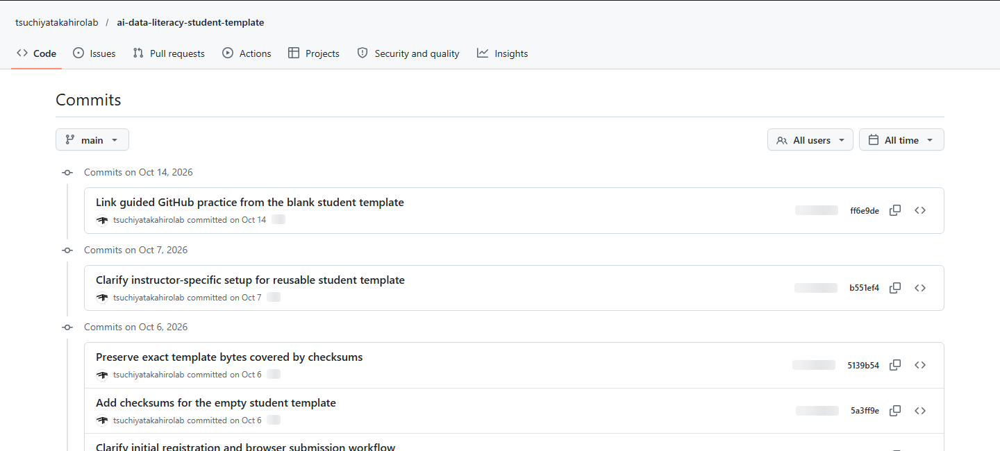
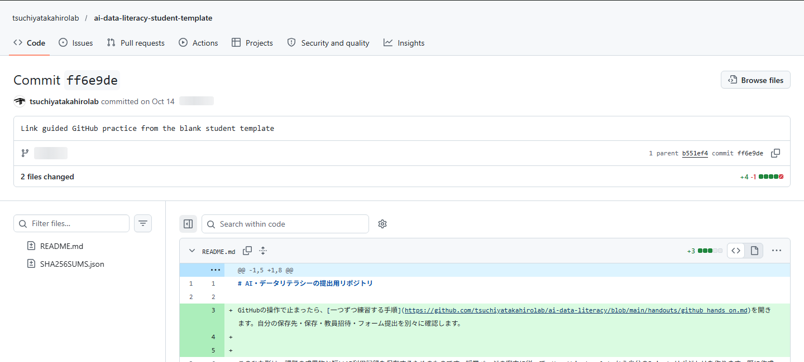

# 自分の説明で理解を確かめる

対応スライド：第12回

## この回で行うこと

AIを練習相手として使い、自分の理解とAIの解説を確かめる。

## 使用する資料

- [ai_tutor_case.md](../assets/week12/ai_tutor_case.md)

## スライドを見ながら進める

### 2. AIを練習相手として使う

**答えだけをもらう**：解答を読むだけでは 理解したか分からない

**練習相手として使う**：答えを隠して出題する 自分で答えて理由を確かめる

### 3. 相関と因果を区別する練習

1. 説明と例を聞く。 2つが違う理由をつかむ。
2. 3問を自分で考えて答える。 最初は正解を表示させない。
3. 解説を教材と比べる。 自分の判断とAIの説明を両方点検する。

### 4. ① 身近な例で説明してもらう

そのままコピーして使えます。内容は自分の課題に合わせて変更してください。

```text
相関と因果の違いを、
大学1年生向けに身近な例で説明してください。
実在の研究結果を使わず、
例は考え方を示す架空の例だと明記してください。
```

説明を読んだら、両者の違いを自分でも1文で書く。

### 5. 同じ傾向が現れる別の理由を考える

暑い日はアイスの売上も プールの利用者数も多い。 アイスが売れたために プールの利用者が増えたと言えるだろうか。

考え方を練習するための架空の例。実際の観測データではない。

### 6. ② 答えを見ずに3問解く

そのままコピーして使えます。内容は自分の課題に合わせて変更してください。

```text
相関と因果を区別する短い問題を
3問作ってください。
1問ずつ出し、私が答えるまでは
正解と解説を表示しないでください。
```

難しい場合は答えを表示する前にヒントを頼む。

### 7. ③ 判断した理由を説明する

1. 相関か因果か判断する。 判断できない場合も理由を書く。
2. 他の説明を1つ考える。 両方に影響する別の要因を考える。
3. その後でAIの解説を読む。 自分の判断理由とAIの解説を比べる。

### 8. AIの採点理由も確認する

**正解と言われたら**：理由まで合っているか。 選択肢を当てただけに なっていないか。

**不正解と言われたら**：何が違うと言われたか。 問題文から判断できるか。 教材の定義と合っているか。

### 9. ④ 曖昧な点を聞き直す

そのままコピーして使えます。内容は自分の課題に合わせて変更してください。

```text
私の説明では、どの点が曖昧ですか。
先ほどの例を使って、1点だけ説明してください。
その後、似た確認問題を1問出してください。
```

すべて説明できたら、別の例を自分で作って確かめてもよい。

### 10. 考えた理由と確認したことを残す

自分が考えた理由と 教材で確認した内容を記録する。 誤りがなければ 無理にやり直す必要はない。

### 11. 成果物と確認記録を保存する

保存先：`week12/`

- README.md：説明・解答理由・確認記録

AIに任せたこと／自分で確かめたこと 確認できなかったこと

### 12. READMEの編集を保存する

1. 自分のPrivateリポジトリで `week12/README.md` を開きます。URLの所有者が自分のusernameか確認します。
2. 鉛筆ボタンで編集し、成果物と自分が確認したことを記録します。
3. **Commit changes** を押し、確認画面でも保存を確定します。ファイル表示に戻り、変更した内容が見えたら完了です。


### 13. Code画面から保存履歴を開く

自分のリポジトリの **Code** を開き、ファイル一覧の上にある時計マークと **Commits** を押します。Commitsという見出しの一覧が開くことを確認します。数字は保存回数で変わります。


### 14. 提出するcommitを選ぶ

最後に保存した内容の見出しを押し、日時と本文を確認します。**Commit** と英数字が表示された詳細画面が開いたら、目的の版か照合します。短い英数字だけを提出しないでください。



### 15. 提出する版の内容とURLを確認する

1. **Browse files** でその版の `week12` を開き、READMEや成果物のファイルを確認します。
2. ブラウザの戻る操作でcommitの詳細画面へ戻ります。
3. Windowsは **Ctrl+L → Ctrl+C**、Macは **Command+L → Command+C** でアドレスをコピーします。
4. URLに **`/commit/`** があり、所有者が自分であることを確認します。
5. 授業の提出フォーム（Week 12を選択）で、そのURL全体を送信します。送信完了画面まで確認します。



初回登録にはリポジトリURL、週次・最終課題には提出内容が含まれるcommit URLを使います。画面例の教員用公開テンプレートを、そのまま提出しないでください。

### 16. 提出前の確認

- [ ] 自分で考えた理由を書いた
- [ ] AIの解説を教材と照合した
- [ ] 理解した点と、残った疑問を区別した
- [ ] 成果物のあるcommit URLを送った

## 使用機能に制限がある場合

有料契約は必要ありません。添付機能が使えなければ本文や小さな表を貼り付け、画像やグラフを生成できなければ文章・表で同じ確認を行います。AIの利用上限や障害で止まった場合は、既に得た出力の確認まで進め、制限があったことを記録してください。機能の利用可否は採点しません。

## 出典と権利

授業用架空資料は、その性質を変えずに使ってください。操作画面はGitHub公式文書または教員の公開テンプレートの表示例です。本文や所有者は学生本人の画面と異なります。公開テンプレートと公式記事の追加撮影日は2026年11月24日です。公式掲載画像の撮影日は不明です。詳しい出典はスライドのノートと[参考資料](../docs/slide_references.md)にあります。
